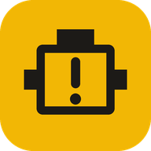

<div align="center">



# Dodge Code Reader

**Read Chrysler / Dodge check-engine codes from a video of the dashboard light.**<br/>
No scanner, no cables. Works on any phone or computer, offline, in Spanish and English.

[](https://eastanganelli.github.io/DodgeCodeReader/)
[](https://github.com/eastanganelli/DodgeCodeReader)

[](https://github.com/eastanganelli/DodgeCodeReader/actions/workflows/deploy-pages.yml)
[](https://github.com/eastanganelli/DodgeCodeReader/issues)


[User guide](docs/user-guide.md) · [Guía de usuario](docs/guia-de-usuario.md) · [Developer guide](docs/developer-guide.md) · [Code list](docs/fault-codes.md)

</div>

---

## What it does

Older Chrysler-group vehicles (for example a 1994 Dodge Dakota) report stored trouble
codes by blinking the check-engine lamp after the key is turned **ON-OFF-ON-OFF-ON**.
Counting those blinks by eye is easy to get wrong. This app does it for you:

1. **Record** the blinking light with your phone (or pick an existing video).
2. The app **finds the light** automatically and draws a box on it. Tap to correct it.
3. It **counts the blinks** and decodes every two-digit code.
4. You get a **clear report**: each active code with a plain-language explanation,
   how serious it is, and how many times it repeated.

```
 ┌──────────────────────────────────────────┐
 │ 43  Engine misfire                        │
 │     ▲ Lamp ON – check soon   Seen 2 times │
 ├──────────────────────────────────────────┤
 │ 33  A/C clutch relay circuit              │
 │     ● Lamp may not stay on   Seen 2 times │
 ├──────────────────────────────────────────┤
 │ 12  Battery was disconnected (normal)     │
 │     ⓘ Information – normal   Seen 2 times │
 └──────────────────────────────────────────┘
```

## Highlights

- **Made for all ages**: step-by-step screens, big buttons, three text sizes, light and
  dark themes, a high-legibility font. Severity is shown by color, icon and text together.
- **Private**: the video is processed on your device and never uploaded.
- **Works offline**: install it as an app (PWA) on Android, iPhone, Windows, Mac or Linux.
- **Smart reading**: finds the lamp on its own, adapts to lighting, and ignores glare and
  camera noise.
- **Honest results**: warns when the end code `55` is missing (incomplete video) and
  flags codes that are not in the reference list.
- **Share** the report by WhatsApp or email, copy it, or print it. The last 10 readings
  are kept on the device.

## Quick start

**Using it:** open **https://eastanganelli.github.io/DodgeCodeReader/** and follow the
[user guide](docs/user-guide.md) ([español](docs/guia-de-usuario.md)).

**Developing:**

```bash
npm install
npm run dev        # http://localhost:3000
npm test           # unit tests
npm run build      # production build in dist/
```

Every push to `main` deploys to GitHub Pages automatically. See the
[developer guide](docs/developer-guide.md) for architecture, testing on real videos and
deployment options.

## Supported codes

34 codes, from `11` (timing / crank-cam sensor) to `65` (power steering switch), with
lamp behaviour (`**` lamp on, `*` intermittent). Full table:
[docs/fault-codes.md](docs/fault-codes.md).

## Built with

React · TypeScript · Vite · Tailwind CSS · vite-plugin-pwa · Canvas 2D (no OpenCV)

## Contributing

Bug reports, new recordings and code improvements are welcome.

- Found a wrong reading? [Open an issue](https://github.com/eastanganelli/DodgeCodeReader/issues)
  with the vehicle (year, model, engine), the codes you expected and, if possible, the video.
- Want to change code? Read the [developer guide](docs/developer-guide.md), run `npm test`,
  and open a pull request.

## Author

<table>
  <tr>
    <td>
      <a href="https://github.com/eastanganelli"></a>
    </td>
    <td>
      <b>Ezequiel Augusto Stanganelli</b><br/>
      Software and firmware developer working on automotive diagnostics.<br/>
      <a href="https://github.com/eastanganelli">@eastanganelli on GitHub</a>
    </td>
  </tr>
</table>

This project grew out of keeping a 1994 Dodge Dakota running: reading flash codes by
counting blinks is slow and error-prone, so the phone does the counting.

## Disclaimer

This tool helps you understand what the engine computer reports. It is not a complete
diagnosis. A code points to the circuit or sensor that reported a problem, not always the
failed part. Check with a mechanic before replacing parts.